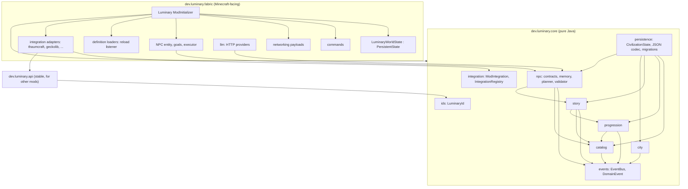

# Luminary system design (proposal)

Status: **designed, not implemented**. Nothing in this document exists as code. Snippets are proposals written for
Java 21 and the Yarn 1.21.1 names listed in `MINECRAFT_FABRIC_1_21_1.md`; on 1.20.1/Java 17 the pure-Java core is
unchanged and only the `fabric` layer differs.

## 1. Design principles

1. **Server is the source of truth.** Clients render; they never decide unlocks, verifications or story phases.
2. **Pure domain core.** `dev.luminary.core.*` has no `net.minecraft`/`net.fabricmc` imports (enforced by a unit test
   that scans imports). Everything there is testable with JUnit in milliseconds.
3. **Events, not calls, across subsystems.** Catalog, Progression, Story, City, NPC talk via a typed in-process event
   bus with an explicit ordering (Catalog → Progression → Story → NPC observers).
4. **Data-driven definitions, code-driven rules.** Eras, technologies, discovery templates and story phases are JSON
   in data packs; validation and transitions are Java.
5. **Idempotent effects.** Every reward, unlock or story event has a stable id and is recorded as executed; replaying
   an event after a crash is a no-op.
6. **No arbitrary timers as progression.** Prerequisites are discoveries, evidence, infrastructure, materials.

## 2. Modules and dependency graph


Allowed direction: `fabric → core`, `fabric → api`, `api → core.ids` only. Forbidden: `core → fabric`, `core → api`,
`catalog → progression` (the Catalog must not know about eras), `story → npc` (the NPC observes story, never the
reverse), any cycle.

Candidate modules that were evaluated and **deferred**: Production (use the host mods' machines; only a "production
observed" signal is needed), Anomaly (needs the Thaumcraft aura port first), a separate Debug module (debug commands
live under `/luminary debug` inside `cmd`).

## 3. Identifiers

`LuminaryId` = `namespace:path`, same grammar as Minecraft `Identifier` (`[a-z0-9_.-]+:[a-z0-9_./-]+`), but a plain
record so core stays Minecraft-free. Namespaces: `luminary` for built-ins, a mod id for content registered by
plugins (`thaumcraft:aspect/ignis`). Ids are **never renamed**; migrations map old → new.

## 4. Catalog of the Unknown (core.catalog)

```java
public enum DiscoveryStatus { OBSERVED, VERIFIED, APPLIED }        // three states required by the owner

public record Attribution(UUID playerId, String nameAtTime, Instant at, String dimension, long blockPosPacked) {}

public sealed interface Evidence permits Evidence.Observation, Evidence.Sample, Evidence.Experiment, Evidence.External {
    LuminaryId id(); UUID contributor(); Instant at();
    record Observation(LuminaryId id, UUID contributor, Instant at, String what) implements Evidence {}
    record Sample(LuminaryId id, UUID contributor, Instant at, LuminaryId itemId, int count) implements Evidence {}
    record Experiment(LuminaryId id, UUID contributor, Instant at, LuminaryId experimentId, Map<String,String> result) implements Evidence {}
    record External(LuminaryId id, UUID contributor, Instant at, String sourceModId, String detail) implements Evidence {}  // e.g. TC4 research completed
}

public record VerificationRequirement(int minDistinctContributors, int minSamples, Set<LuminaryId> requiredExperiments,
                                      Set<LuminaryId> requiredVerifiedDiscoveries) {}

public record DiscoveryTemplate(LuminaryId id, String titleKey, VerificationRequirement verification,
                                Set<LuminaryId> dependsOn, Visibility visibility) {}   // Visibility: PUBLIC_WHEN_VERIFIED | RESTRICTED(roleId)

public record DiscoveryRecord(LuminaryId id, DiscoveryStatus status, Attribution firstObserver,
                              List<Evidence> evidence, List<StatusChange> history) {}
public record StatusChange(DiscoveryStatus from, DiscoveryStatus to, Instant at, String reason, UUID actor) {}
```

`CatalogService` (pure Java) rules:

- `observe(templateId, Attribution)` creates OBSERVED once; later observers are appended as `Evidence.Observation`
  and never overwrite `firstObserver` (attribution is permanent).
- `addEvidence(...)` is idempotent on `Evidence.id()`.
- `tryVerify(templateId, actor)` succeeds only when the `VerificationRequirement` is satisfied **and** all
  `dependsOn` are VERIFIED; emits `DiscoveryVerified`. An admin override exists but records `reason = "admin"`.
- `markApplied(templateId)` is called **by Progression** when a technology that consumes the discovery is unlocked;
  the Catalog cannot decide application on its own (keeps the "knowledge ≠ capability" rule).
- "Acquiring an advanced item early" never creates a record: items are inputs to `Evidence.Sample`, and Progression
  gates usage separately (see §5), so a looted artifact can be catalogued but not used.

## 5. Progression (core.progression)

```java
public record Era(LuminaryId id, int order, String titleKey) {}
public sealed interface Prerequisite permits Prerequisite.EraAtLeast, Prerequisite.DiscoveryVerified, Prerequisite.TechnologyUnlocked,
                                             Prerequisite.Facility, Prerequisite.Signal {
    record EraAtLeast(LuminaryId era) implements Prerequisite {}
    record DiscoveryVerified(LuminaryId discovery) implements Prerequisite {}
    record TechnologyUnlocked(LuminaryId tech) implements Prerequisite {}
    record Facility(LuminaryId facilityType, int minCount) implements Prerequisite {}     // from City
    record Signal(LuminaryId signalId, long minValue) implements Prerequisite {}          // from integrations, e.g. "create:kinetic_network_running"
}
public record Technology(LuminaryId id, LuminaryId era, Set<Prerequisite> prerequisites, Set<LuminaryId> appliesDiscoveries,
                         Set<LuminaryId> grantsCapabilities) {}
```
`ProgressionService.evaluate(CivilizationState)` returns newly satisfiable technologies; `unlock(techId, actor)` is
idempotent, emits `TechnologyUnlocked`, and asks the Catalog to mark `appliesDiscoveries` APPLIED. Era advancement is
itself a technology-like definition (`luminary:era/town` with prerequisites), so new eras are JSON, not code.

**Enforcement in the world** (fabric layer, LIKELY APIs): capabilities map to (a) recipe visibility/unlock via
`ServerPlayerEntity.unlockRecipes` or a recipe-condition integration, (b) `UseItemCallback`/`UseBlockCallback`
denials for items tagged `luminary:requires/<capability>` with a feedback message, (c) advancement grants for UI.
Vanilla recipes cannot be conditionally disabled without a data pack or a mixin; the practical route is a Luminary data
pack that removes/replaces gated recipes plus item tags (recommendation, UNVERIFIED in-game).

## 6. Persistence (core.persistence + fabric.state)

```java
public record CivilizationState(int schemaVersion, CatalogState catalog, ProgressionState progression,
                                StoryState story, CityState city, Set<String> executedEffectIds) {}
```
- JSON via Gson into a single string inside `LuminaryWorldState extends PersistentState` (`<world>/data/luminary.dat`).
  `markDirty()` after every mutation; vanilla saves it with the world (autosave, `/save-all`, shutdown).
- `SchemaMigrations`: ordered `Migration(fromVersion) { JsonObject apply(JsonObject) }`; applied before decoding;
  unknown future version → refuse to load and keep the file (fail closed, log loudly) rather than overwrite.
- Corrupt JSON → rename to `luminary.dat.corrupt-<timestamp>` is **not** possible from inside `PersistentState`
  (vanilla owns the file); instead keep a rolling JSON backup under `<world>/luminary/backups/` written on
  `ServerLifecycleEvents.AFTER_SAVE` from a snapshot taken on the server thread and written on a worker thread.
- NPC memory lives in **its own** `PersistentState` (`luminary_npc.dat`) or per-NPC files, because it grows and
  changes more often.
- Duplicate prevention: `executedEffectIds` is checked before applying any reward/story effect; ids are
  deterministic (`"story:phase_ii:announce"`, `"catalog:verified:thaumcraft:aspect/ignis:reward"`).
- Client responsibility: only presentation caches synced via S2C payloads; a reconnect re-syncs from the server.

Alternatives considered: SQLite (adds a native dependency and a second source of truth; rejected until a query need
appears), one JSON file per subsystem (more files, same guarantees; acceptable later), Minecraft `Codec`s (fine for the
fabric layer; the core stays Gson/plain JSON to remain Minecraft-free).

## 7. Story (core.story)

```java
public record StoryPhase(LuminaryId id, int order, List<Prerequisite> activationConditions, Set<LuminaryId> clueIds) {}
public record StoryState(LuminaryId currentPhase, Map<LuminaryId, Instant> enteredAt, Set<LuminaryId> revealedClues) {}
public final class StoryController {
    /** Only administrators call this; the LLM layer has no reference to it. */
    public Result setPhase(LuminaryId phase, Actor admin) { ... }
    /** Called each evaluation cycle; advances ONLY if conditions hold AND the phase is marked autoAdvance=true. */
    public Optional<LuminaryId> evaluateAutoAdvance(CivilizationState s) { ... }
    public boolean mayReveal(LuminaryId clueId, StoryState s) { ... }   // the NPC asks this before any clue line
}
```
Phases 0–VI as named by the owner are JSON data with `order`; strategic approaches (containment / investigation /
exploitation) are a `StoryBranch` chosen by an admin command or by a civilization vote facility, persisted, and read by
Progression as `Prerequisite.Signal("luminary:branch", ...)`.

## 8. City (core.city)

Keep minimal: `Facility(LuminaryId type, UUID id, RegionRef region, UUID founder, Instant since)` registered by a
player with a tool or command inside a claimed region; a facility type is *recognized* by a validator (e.g. "contains
≥ 1 lectern and ≥ 4 bookshelves and a Luminary archive block") run on demand, not every tick. The Luminarium is a
`Facility` of type `luminary:luminarium` that unlocks the archive UI, project board and verification actions. No city
simulation.

## 9. Events (core.events)

Sealed `DomainEvent` with records `DiscoveryObserved`, `DiscoveryVerified`, `DiscoveryApplied`,
`TechnologyUnlocked`, `EraEntered`, `StoryPhaseChanged`, `ClueRevealed`, `FacilityRegistered`, `NpcTaskCompleted`.
Synchronous dispatch on the server thread, listeners ordered by a declared priority; a listener exception is logged and
isolated. This is deliberately not Fabric's `Event` so core tests need no Fabric.

## 10. Luminarium functions → systems

| Function | Backed by |
|---|---|
| Shared archive | Catalog records with `visibility`, rendered by a book UI (Modonomicon) or a custom screen |
| Research institute | `Evidence.Experiment` producers: experiment definitions with required facility + inputs |
| School/workshops | NPC teaching role (`npc.teach` intents read only VERIFIED+PUBLIC entries) |
| Project board | `CityState.projects`: title, needs (items/discoveries), contributors; purely cooperative bookkeeping |

## 11. Suggested first implementation slice (when authorized)

1. `core.ids`, `core.events`, `core.catalog` with full unit tests (attribution permanence, idempotent evidence,
   verification rules).
2. `core.persistence` JSON round-trip + one migration test.
3. Fabric layer: `LuminaryWorldState`, `/luminary catalog observe|evidence|verify|list` for admins, `/luminary status`.
4. One GameTest: run the commands on a GameTest server and read back the state.
Then Progression, then Story, then the NPC entity (see `AI_NPC_TECHNICAL_RESEARCH.md` §8).
