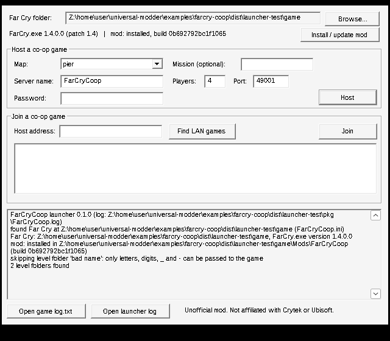

# FarCryCoop: co-op for Far Cry (2004)

An experimental co-op mod for the original Far Cry on PC, patch 1.4. One player hosts a campaign level as a
multiplayer server, others join, and the server runs the enemies for everyone. It is built on Crytek's own
netcode. There's no second game engine and no external simulation.

> **Status: built and tested outside the game, not yet run inside Far Cry.** Everything here was written and
> compiled in a Linux container without a copy of Far Cry, a Windows PC or a GPU. The binaries load and run
> under Wine, and the network and Lua code pass automated tests. No co-op session has been played. The first
> run on a real install is the [in-game test plan](#in-game-test-plan) below.



## What is in the package

| File | What it is |
|---|---|
| `FarCryCoop.exe` | Windows launcher (32-bit, no runtime needed) **with the whole mod embedded**. It finds the game, installs the mod with a backup, then hosts, joins and finds LAN games. It also has a command-line mode. This one file is enough. |
| `EULA.txt` | The CryENGINE MOD SDK license that covers the DLL. It must ship with it; it is also installed next to the DLL. |
| `README_RU.txt` | Short guide in Russian. |
| `tools/audit_scripts.py` | Scans your own `Scripts.pak` and level paks for single-player assumptions (campaign compatibility report). |

Installed into `<Far Cry>\Mods\FarCryCoop`:

| File | What it is |
|---|---|
| `Bin32/CryGame.dll` | Far Cry's game DLL rebuilt from the official CryENGINE MOD SDK 1.4 source, plus the co-op hooks. Far Cry 1.4 loads it only while `-MOD:FarCryCoop` is active. |
| `Scripts/Coop/GameRules.lua` | The `Coop` game type. It gives each client a player and handles respawning, leaving and friendly fire, on top of your own single-player rules. |
| `EULA.txt`, `ModDesc.txt`, `README.txt` | License, Mods-menu text, short readme. |

No original game file is included or changed. You need your own Far Cry, updated to 1.4. The Far Cry VR mod
has the same 1.4 requirement and installs straight onto the Steam and GOG releases. The launcher reads
`FarCry.exe`'s version and warns if it isn't 1.4.

## Feature status

**Verified** means checked by an automated test or by reading the SDK source. **Unverified** means it still
needs a real game session.

| Feature | Status |
|---|---|
| CryGame.dll compiles from the SDK 1.4 source (clang-cl, MSVC ABI, i686) | Verified: builds, exports `CreateGameInstance` and `CryModuleGetMemoryInfo`, imports only system DLLs |
| CryGame.dll loads on Windows, binds to CrySystem's allocator, constructs the game object | Verified under Wine with a stub CrySystem.dll (stock and co-op builds) |
| The co-op DLL behaves like stock outside `g_GameType=Coop` | By construction: every hook returns early unless co-op is active. Not tested in game |
| Launcher: install detection, 1.4 version gate, level list, install with backup, start the game in `Bin32` | Verified under Wine against a fake install (26 checks) |
| Single-file `FarCryCoop.exe` installs the embedded mod byte for byte | Verified under Wine |
| LAN discovery between launchers, with a mod build check | Verified under Wine on loopback. Real LAN broadcast is unverified |
| Launch request parser (`-coophost:` / `-coopjoin:`), injection-safe | Verified (26 checks) |
| Lobby protocol validation (malformed, oversize, non-ASCII, wrong nonce) | Verified (29 checks, plus 200k fuzzed datagrams under ASan/UBSan) |
| Co-op rules: per-client players, respawn delay and auto-respawn, checkpoint respawn point, disconnect, friendly fire | Verified in Lua 5.0.3 against mocked engine objects (45 checks). Unverified in game |
| Host and join through Far Cry's own server (`Game:LoadLevelListen`, `Game:Connect`) | Unverified |
| Enemies keep thinking in multiplayer (an AI watchdog ticks AI if the engine stops) | Unverified |
| Enemies replicate to clients (net presence on AI actors), with client-side AI disabled | Unverified |
| Enemies perceive and target every human player | Unverified |
| Movement, aiming, weapons, reload, stance, damage, deaths | Uses the stock multiplayer replication (`CPlayer::Write/Read`). Unverified for AI actors |
| Doors, switches, alarms and other entity state | Stock entity-state replication. Unverified per level |
| Checkpoints become the shared respawn point instead of saving | Unverified |
| Internet play | Not tested. Far Cry's server uses UDP 49001, and the host must forward it |
| Campaign level transitions keep the session (the server changes level, clients stay connected) | Implemented in the DLL. Unverified in game |

## How it works

Far Cry's single player already runs as a local server with one local client (`CXServer` and
`CXServerSlot`). Multiplayer adds remote slots, reliable messages for spawns and state changes, and
bandwidth-budgeted unreliable entity snapshots. Co-op mostly means lifting single-player assumptions inside
that design:

1. **Host** sets `g_GameType=Coop` and calls `Game:LoadLevelListen(map)`: a listen server with the
   host's own client.
2. **Clients** connect with `Game:Connect(ip)`. The engine checks that both run the same mod, takes the
   game type from the server and loads the level locally, so every level entity exists on every machine
   with the same ID.
3. **Server rules** (`Scripts/Coop/GameRules.lua`) load your own single-player `GameRules.lua`, so damage,
   difficulty and AI hits behave as in the campaign. They then spawn a player per client and handle
   respawns.
4. **Co-op hooks in CryGame.dll** (`crygame/coop/Coop.cpp`, 4 small patches to SDK files):
   - The server enables *net presence* on AI soldiers, so their position, stance, weapon and firing go out in
     the normal snapshots.
   - It registers every human player as an AI target.
   - An AI watchdog: the engine passes `ESYSUPDATE_MULTIPLAYER` to CrySystem.dll in MP, and what that skips
     is closed source. The DLL watches `IAISystem::GetAITickCount()` and only updates AI itself if the count
     stops moving.
   - On pure clients, the local copies of AI agents are disabled; the server drives them.
   - `Game:TouchCheckPoint` moves the shared respawn point instead of saving.
   - `Game:LoadLevel` from campaign scripts changes level on the server the way MP map rotation does
     (`LoadLevelCS` keeping the clients, listen server), instead of dropping back to single player. A pure
     client ignores the call, because the server drives it.
   - The launcher's request is read from the command line and executed once the main menu is up.

## Install

1. Update Far Cry to **patch 1.4**.
2. Extract `FarCryCoop-0.2.0.zip` anywhere. `FarCryCoop.exe` carries the mod inside. A `mod\FarCryCoop`
   folder next to it, if present, is used instead (for development).
3. Run `FarCryCoop.exe`. It looks for the game next to itself, then in Steam libraries, GOG and the Windows
   uninstall list. If it doesn't find it, click **Browse...** and pick the folder that contains
   `Bin32\FarCry.exe`.
4. Click **Install / update mod**. This copies the mod to `<Far Cry>\Mods\FarCryCoop`. An older copy is
   renamed to `FarCryCoop.backup-<date>` first. Nothing else in the game folder is written.

Every player needs the same package. The launcher shows a build ID; it must match across players.

## Host a game

1. Pick a **Map** (the folders under `<Far Cry>\Levels`), and optionally a mission name.
2. Set the server name, players (2 to 16), port (default 49001) and an optional password.
3. Click **Host**. Far Cry starts and loads the level as a co-op listen server. While it runs, the launcher
   answers LAN discovery.
4. For players outside your LAN, forward **UDP 49001** (or your port) to the host PC. Internet play is
   untested.

Command line: `FarCryCoop.exe --host pier --max 4 --name "My game"` (`--dry-run` prints the Far Cry command
instead of starting it).

## Join a game

1. Click **Find LAN games** and pick a host, or type the host's IP address.
2. Click **Join**. Far Cry starts and connects; the game shows whether it succeeded. The launcher can't see
   the in-game connection, and it never says you are connected.

Command line: `FarCryCoop.exe --join 192.168.1.20`. Without the launcher, from `Bin32`:
`FarCry.exe -MOD:FarCryCoop -coopjoin:192.168.1.20`.

## Console and settings

Open the console with `~`.

| Command / variable | Meaning |
|---|---|
| `coop_status` | Prints the co-op state: role, slots, AI tick and watchdog, replicated AI count, frozen client AI, respawn point |
| `coop_friendlyfire` (0) | 1 = players can hurt each other |
| `coop_respawn_delay` (5) | Seconds before a dead player can respawn (fire to respawn) |
| `coop_auto_respawn` (20) | Seconds until a dead player respawns anyway; 0 = never |
| `coop_sp_connect` (0) | 1 = let the single-player rules spawn the first (host) client (for testing) |
| `coop_ai_server_update` (1) | AI watchdog on/off |
| `coop_ai_netpresence` (1) | Replicate AI actors to clients |
| `coop_player_ai` (1) | Register human players as AI targets |
| `coop_client_ai_freeze` (1) | Disable local AI agents on clients |
| `coop_debug` (0) | More `[coop]` log lines |

Stock netcode settings work as usual: `sv_maxplayers`, `sv_password`, `sv_timeout`, `sv_maxrate_lan`,
`cl_updaterate`, and `sv_netstats` for bandwidth. Crytek's internet simulator is also available:
`g_internet_simulator_ping` and `g_internet_simulator_packetloss`.

## Troubleshooting

| Problem | What to check |
|---|---|
| "needs Far Cry patch 1.4" | Patch the game. The DLL is built against 1.4 binaries. `--ignore-version` exists, but expect crashes |
| Far Cry starts but nothing happens | Look in `<Far Cry>\log.txt` for `[coop] launch request` and `[coop] FarCryCoop CryGame.dll loaded`. If the second is missing, the mod DLL was not loaded. Check that `Mods\FarCryCoop\Bin32\CryGame.dll` exists and you are on 1.4 |
| Crash at startup with the mod | Note the last lines of `log.txt`, then delete `Mods\FarCryCoop` to restore stock behaviour. If the stock-built DLL (`STOCK=1 crygame/build.sh`) crashes as well, the compiler ABI is to blame. Rebuild with Visual Studio 2022 (see Build) |
| "Wrong Mod" when joining | The client didn't start with `-MOD:FarCryCoop`; use the launcher |
| Join times out | Is the host's level loaded yet? Is UDP 49001 open on the host firewall or router? `sv_timeout` sets the client timeout |
| Find LAN games shows nothing | The host must have started from FarCryCoop.exe, and UDP 49099 must not be blocked. You can still type the IP |
| Enemies frozen on the host | `coop_status`: if `aiFallback=0` and `aiTick` doesn't move, report it. Try `coop_ai_server_update 1` |
| Enemies invisible or frozen on clients | `coop_status` on the host should show `aiNetPresence>0`. Try `coop_client_ai_freeze 0` to compare |
| Players can't respawn | Check `coop_respawn_delay` and `coop_auto_respawn`. Without a checkpoint or level respawn point, the log shows `WARNING: no checkpoint` |
| Logs | `FarCryCoop.log` next to the launcher, and `log.txt` in the Far Cry folder (`[coop]` lines; `log_verbosity 8` for more) |

## Compatibility

| Game version | Status |
|---|---|
| Far Cry 1.4 (retail patch, Steam, GOG), 32-bit `Bin32` | Target. Untested in game |
| 1.0 to 1.33 | Not supported (the SDK DLL requires 1.4). The launcher refuses unless `--ignore-version` |
| 64-bit `Bin64` | Not supported (32-bit DLL only) |

| Level | Status |
|---|---|
| All campaign levels | **Not tested.** Run `python3 tools/audit_scripts.py "<Far Cry>"` for a per-level list of the scripts that assume a single player (`_localplayer`, level transitions, saves, HUD and cutscene calls) |
| Stock MP maps with `g_GameType=Coop` | Not tested. They have no AI, so this is only useful as a connection test |

## Known issues and limitations

- **Untested in game.** The co-op behaviour of the DLL and rules is designed from the SDK source but has not
  run. See the in-game test plan.
- **Level transitions are new and untested.** The DLL keeps the session across `Game:LoadLevel`, and players
  respawn at the next level's start. Weapons don't carry over; each level gives its mission loadout. If a
  transition misbehaves, the host can start the next level from the launcher and clients rejoin.
- **`_localplayer` on the server is the host.** Mission triggers and objectives written for "the player" may
  only react to the host. `audit_scripts.py` lists them per level.
- Cutscenes, HUD messages and input changes from server scripts only show on the host.
- Saving is disabled in multiplayer, which is engine behaviour. Checkpoints only move the respawn point.
- AI on clients is rendered from snapshots. Animation smoothness of AI actors on clients is unknown.
- `-coopjoin:ip:port` for hosts on a non-default port goes through the closed CryNetwork.dll's address
  parser. Untested.
- The CryGame.dll is built with clang-cl instead of MSVC. clang-cl targets the MSVC ABI, and the VR mod shows
  a VS2022 build of this source works with the 1.4 engine. Our build itself has only been load-tested.

## Build from source (Linux or WSL)

Needs clang/lld 18, mingw-w64, and `xwin` (`cargo install xwin`) for the MSVC CRT and Windows SDK.

```bash
xwin --accept-license --arch x86 splat --output ~/xwin   # Microsoft CRT + SDK (build-time only)
STOCK=1 crygame/build.sh   # unmodified SDK DLL, the baseline
crygame/build.sh           # co-op DLL -> dist/build/coop/CryGame.dll
launcher/build.sh          # -> dist/build/FarCryCoop.exe
tests/run_all.sh           # every automated test (needs wine for the Windows parts)
tools/package.sh           # -> dist/FarCryCoop-0.2.0.zip (+ .sha256)
```

`crygame/build.sh` fetches the SDK 1.4 CryGame source from `github.com/fholger/farcry_vrmod` at commit
`ef7b86c`, the stock SDK plus VS2022/STLport compile fixes. It then applies the compile-only fixes in
`crygame/toolchain_fixes.py` and the co-op patches in `crygame/patches/`, adds `crygame/coop/*`, and compiles
with clang-cl and lld-link. Set `FC_SDK_SRC` to use your own SDK copy.

**Visual Studio 2022 instead:** open `Solution1.sln` from that SDK checkout, apply `crygame/patches/*.patch`
(`patch -p1` inside `CryGame/`), add `crygame/coop/Coop.cpp` and `CoopArgs.cpp` to the CryGame project, and
build Release|Win32.

## In-game test plan

Run this in order on a real install; each step names the evidence to look for. Use two PCs on a LAN; one PC
with two windowed instances may work if the game allows a second instance (untested).

1. **DLL loads.** Host any level. `log.txt` contains `[coop] FarCryCoop CryGame.dll loaded` and
   `[coop] launch request: host map ...`. If it crashes, try the stock-built DLL to separate a toolchain
   problem from a co-op problem.
2. **Session up.** `coop_status` on the host shows `active=1 role=host`. The level loads and you can play.
3. **AI on the host.** Enemies react and fight. `coop_status` shows whether the watchdog had to tick AI
   (`aiFallback`).
4. **Client joins.** The client is placed near the host or the level respawn point. Both players see
   each other move, aim, change weapons and shoot.
5. **AI on the client.** On the client, enemies move and fire in sync with the host (`clientFrozenAI>0` on
   the client, `aiNetPresence>0` on the host).
6. **AI targets both players.** Enemies notice and attack the client, not only the host.
7. **Damage and death.** Enemies die from either player's fire. A dead player respawns after the delay.
8. **Checkpoint.** Reaching a checkpoint prints "Checkpoint reached" and later respawns happen there.
9. **Level end.** Finish the level. Everyone sees "Level complete: loading ...", `log.txt` shows
   `[coop] level transition`, and the client stays connected into the next level.
10. **Disconnect.** A client quits. The host continues, and the client's body is removed.
11. **Soak.** Play 30 minutes. Note `sv_netstats 1` bandwidth, ping (scoreboard) and any desync.

Record the results in the compatibility table and in the knowledge base note
(`knowledge/games/far-cry/`).

## Next steps

1. Run the in-game test plan on one campaign level and fix what breaks.
2. Make mission triggers react to any player: a `_localplayer` shim that points server-side scripts to the
   nearest or triggering player.
3. Sync objectives and HUD messages to all clients (`ServerSlot:SendCommand`).
4. Interpolation and animation check for AI actors on clients, and tuning of `sv_maxrate_lan` and snapshot
   rate for many AI.
5. A Visual Studio build in CI to compare with the clang-cl DLL.

## Credits and legal

- Built on the **CryENGINE MOD SDK 1.4 for Far Cry** by Crytek. The CryGame.dll and the patches are
  modifications under that license (`EULA.txt`, which must accompany the DLL; free, electronic distribution
  only, for the full retail game).
- SDK sources via **Far Cry VR** by Holger Frydrych (fholger), whose repository hosts the SDK with VS2022
  fixes.
- Launcher, co-op code, rules, tools and tests: written for this project with AI assistance (Claude Code),
  MIT licensed like this repository, except the SDK-derived parts noted above.
- Unofficial. Not affiliated with or endorsed by Crytek or Ubisoft. Far Cry is a trademark of Ubisoft
  Entertainment; CryENGINE is a trademark of Crytek GmbH.
