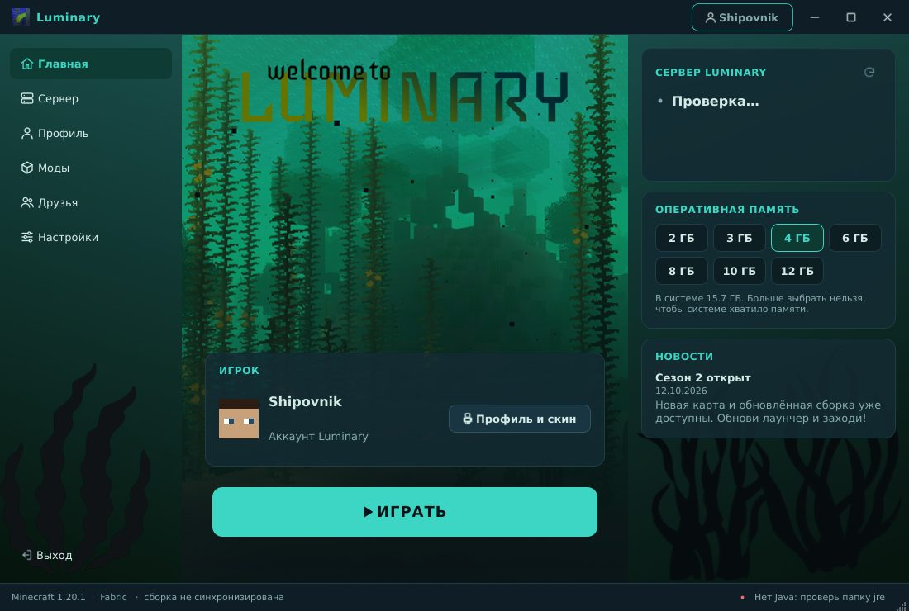
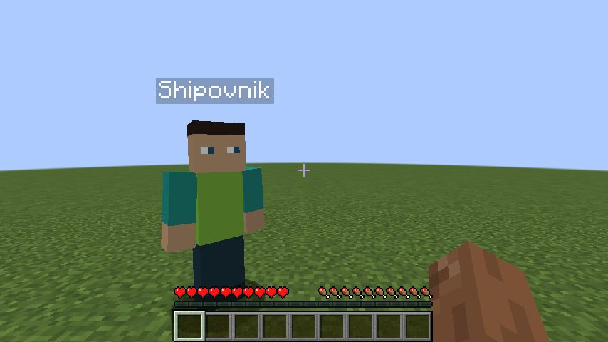

# Luminary

The launcher, accounts service and skin system for the Luminary Minecraft server (1.20.1, Fabric).



| Folder | What |
|---|---|
| `launcher/` | The desktop launcher: PySide6, run by the bundled portable Python 3.11. Entry point `launcher.py`, started by `Luminary.exe`. |
| `backend/` | Accounts service: FastAPI + SQLite. Registration and login, skins, friends, news, and the Yggdrasil API that authlib-injector uses. |
| `docs/` | `DEPLOYMENT.md` (backend, server cutover, release), `SECURITY.md`, `TESTING.md`, screenshots. |
| `PROGRESS.md` | Decisions, status and the remaining owner actions. |

How a skin reaches other players:

```
launcher ──upload PNG──▶ accounts service ──signed textures──▶ Minecraft server (online-mode + authlib-injector)
   │                          ▲   ▲                                  │
   └─ game token + authlib ───┘   └──────── hasJoined ───────────────┘──▶ other players' clients render it
```



## Run locally

Backend (Python 3.10+):

```sh
cd luminary/backend
python -m venv .venv && . .venv/bin/activate && pip install -e ".[test]"
LUMINARY_DATA_DIR=./data LUMINARY_PUBLIC_URL=http://localhost:8080 python -m luminary_auth --port 8080
pytest -q
```

Launcher in development (any OS; Windows is the target):

```sh
cd luminary/launcher
pip install PySide6==6.11.2 mcstatus==14.2.0
# point it at the local backend (optional): "accounts": {"api_url": "http://localhost:8080"} in profiles.json
python launcher.py --console          # logs also go to the terminal
QT_QPA_PLATFORM=offscreen pytest -q tests
```

Playing needs the Windows distribution folder: `LuminaryLauncher.exe` (PortableMC 5.0.5), `jre\`
and `python\`. See `docs/DEPLOYMENT.md`.
